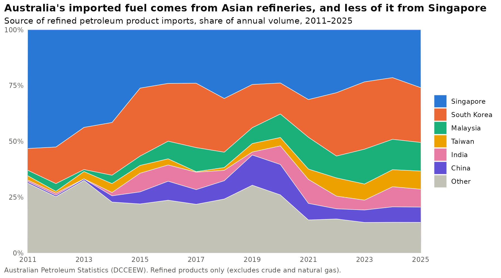
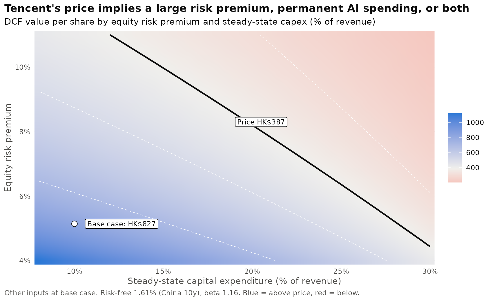
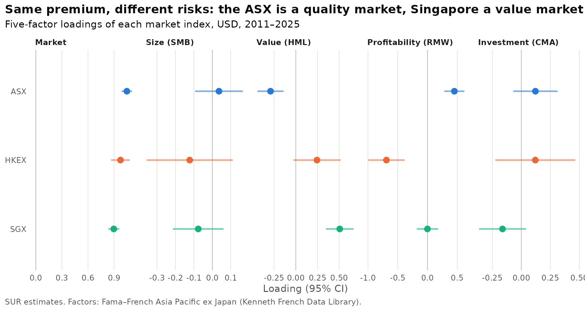
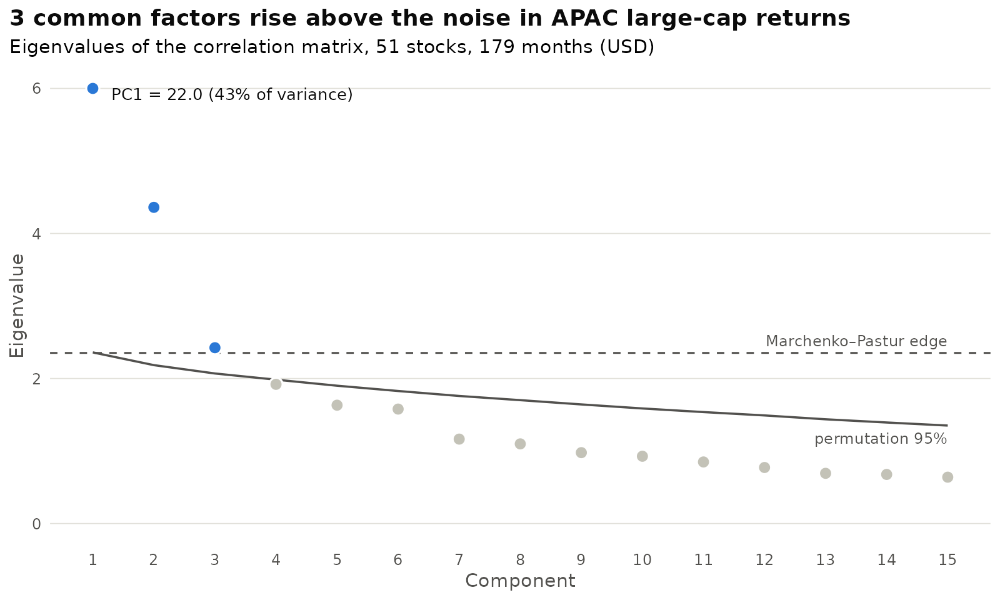
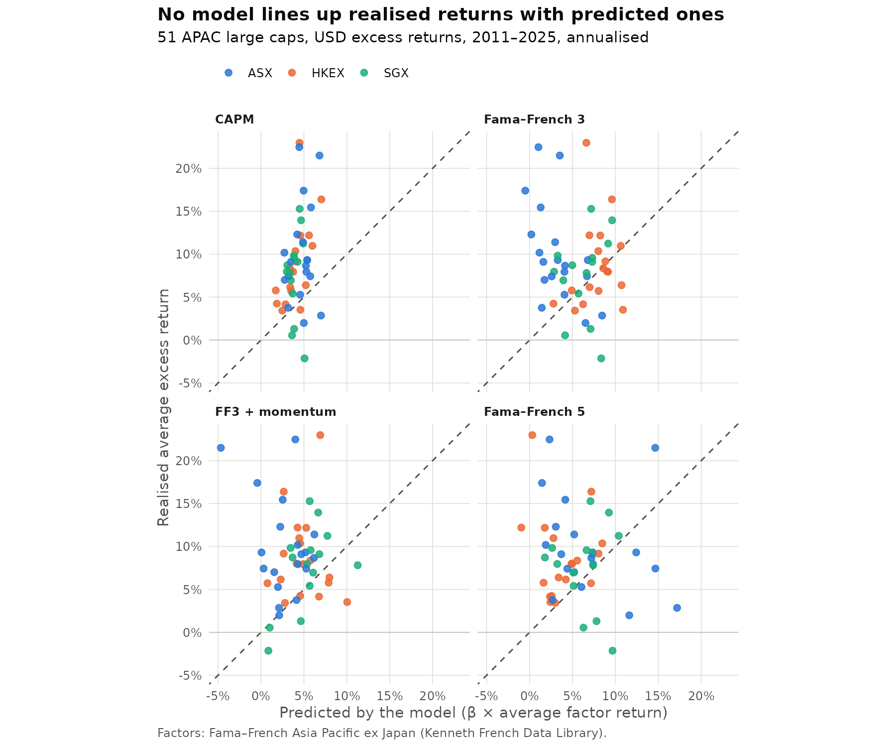

# APAC Asset Pricing

Statistical asset pricing and valuation across the ASX, HKEX and SGX: factor models, valuation, commodities and event studies, in R. Each module opens with its answer, and each feeds the next. Module 01's betas go into Module 06's cost of capital, and Module 03's factor tests set up Module 05's cross-market comparison.

**Read online:** [kyanite03.github.io/apac-asset-pricing](https://kyanite03.github.io/apac-asset-pricing/)

## Latest: Module 08, oil in Asia-Pacific

- **Australia's fuel runs through Asian refineries.** Domestic refining halved after the 2021 closures and product imports rose 50%. In 2025, 96% came from Asian refiners (Singapore 26%, South Korea 25%, Malaysia 13%). Stock cover averages 60 IEA days against a 90-day obligation.
- **Asia's Dubai benchmark broke from Brent in 2026:** the spread, normally about $2, reached $27.7 in April.
- **APAC energy stocks carry oil exposure in the expected order** (producers ~0.25–0.34, Sinopec ~0.04), but regional fundamentals add nothing beyond the price, and up/down asymmetry is not robust.
- **Oil risk is not priced** across the 51-stock universe (Fama–MacBeth premium −0.42% a month, t = −0.25).

[Full write-up](https://kyanite03.github.io/apac-asset-pricing/modules/08-oil-asia-pacific/) · [source](modules/08-oil-asia-pacific/index.qmd)

## Module 06, valuing Tencent

- **On standard inputs Tencent is worth about HK$827 a share, against a price of HK$386.6.** The sum-of-the-parts DCF uses China's 10-year yield, Damodaran's China risk premium and Module 01's beta, with figures extracted (and cross-checked) from Tencent's 2022–25 annual and 2026 interim reports.
- **The price implies either a 13.6% WACC (an equity risk premium near 12%) or AI capex at 28% of revenue forever.** Realistic combinations, such as an 8% premium with 20% capex, reproduce it.
- **Monte Carlo** (10,000 draws): median HK$559, 90% interval HK$391–840. The equity risk premium and steady-state capex drive most of the uncertainty; growth matters less.

[Full write-up](https://kyanite03.github.io/apac-asset-pricing/modules/06-dcf-tencent/) · [source](modules/06-dcf-tencent/index.qmd)

## Module 05, cross-market comparison

- **Same premium:** 5.4% (ASX), 4.1% (HK) and 5.5% (SG) a year in USD over T-bills. A joint test of equality gives p = 0.89.
- **Different risks:** in a SUR system, the markets' value and profitability loadings differ sharply (p < 1e-6). The ASX is a profitable/growth market, Hong Kong the reverse, and Singapore a value market. Net of the regional market, ASX and HK residuals correlate −0.64.
- **One estimated break,** in Singapore (June 2021, beta 0.94 → 0.64). It coincides with Hong Kong's correlation with both other markets falling (with the ASX, 0.67 → 0.37).

[Full write-up](https://kyanite03.github.io/apac-asset-pricing/modules/05-cross-market-asx-hk-sg/) · [source](modules/05-cross-market-asx-hk-sg/index.qmd)

## Module 04, statistical factors

- **Three common risks rise above the noise** (Marchenko–Pastur edge and permutation test agree): the regional market (43% of variance), **Hong Kong/China vs Australia**, and **energy vs utilities**.
- **The Fama–French factors capture the first, part of the second and little of the third** (canonical correlations 0.98, 0.68, 0.32). The energy factor is only 30% explained by any observable tested.
- **Out of sample** (factors from half the stocks in 2011–18, tested on the other half in 2019–25), statistical factors leave smaller pricing errors than the CAPM or FF5 (median RMS alpha 8.2% vs 9.5%), though with low power.

[Full write-up](https://kyanite03.github.io/apac-asset-pricing/modules/04-statistical-factors-apt/) · [source](modules/04-statistical-factors-apt/index.qmd)

## Module 03, testing pricing models

- **All four models are rejected** (CAPM, Fama–French 3, FF3 + momentum, FF5; GRS p ≤ 0.005). But 88% of CAPM alphas are positive, averaging 4.6% a year. That is the signature of a survivor sample, not of a missing factor.
- **Extra factors explain more variance but price no better.** R² rises from 40% to 47%, yet the CAPM has the smallest root-mean-square alpha.
- **Beta is priced roughly as the CAPM says** (7.1% a year vs a 4.5% market premium, with an insignificant zero-beta intercept). This overturns an earlier flat-line result from a 16-stock ASX sample, though with low power (t = 0.94).

[Full write-up](https://kyanite03.github.io/apac-asset-pricing/modules/03-testing-pricing-models/) · [source](modules/03-testing-pricing-models/index.qmd)

## Module 01, CAPM and the market model

- **Most APAC large caps move less than their market.** 31 of 51 stocks have a beta below 1. Financials sit above 1. Utilities, telecoms, health care and, perhaps surprisingly, most resource names sit below.
- **Betas shifted after 2020, by sector.** China's big three state banks decoupled from the Hang Seng (beta about 1.2 → 0.5). All eight resource and energy names became less market-sensitive, and all four Australian majors became more so.
- **No stock has a significant alpha** once the 51 tests are corrected for false discoveries.

[Full write-up](https://kyanite03.github.io/apac-asset-pricing/modules/01-capm-market-model/) · [source](modules/01-capm-market-model/index.qmd)

## Modules

| # | Module | Question | Status |
|---|--------|----------|--------|
| 01 | [CAPM and the market model](modules/01-capm-market-model/) | How market-sensitive are APAC large caps, and are their betas stable? | Done |
| 02 | Factor construction | Can SMB/HML be built for the ASX from fundamentals? | Planned |
| 03 | [Testing pricing models](modules/03-testing-pricing-models/) | CAPM vs zero-beta CAPM vs Fama–French: which prices APAC returns? | Done |
| 04 | [Statistical factors (APT)](modules/04-statistical-factors-apt/) | How many factors drive APAC returns? | Done |
| 05 | [Cross-market comparison](modules/05-cross-market-asx-hk-sg/) | Are factor premia equal across the three markets? | Done |
| 06 | [Valuing Tencent (DCF)](modules/06-dcf-tencent/) | What is Tencent worth, and what does its price assume? | Done |
| 07 | Bank valuation, HK & SG | Why do Chinese banks trade at a discount to Singapore's? | Planned |
| 08 | [Oil in Asia-Pacific](modules/08-oil-asia-pacific/) | Regional oil fundamentals, energy-stock exposure, and whether oil risk is priced | Done |
| 09 | The David Jones collapse | Who bore the cost of DJ's administration? | Planned |

## Rigour

- Every estimator is written in matrix form in [`R/models_linear.R`](R/models_linear.R): OLS, Newey–West HAC, GLS, seemingly unrelated regressions (SUR), general linear hypotheses, the GRS test, and Fama–MacBeth with Shanken errors. Principal components, the Marchenko–Pastur edge, parallel analysis and eigenportfolios are in [`R/models_factor.R`](R/models_factor.R).
- Each is unit-tested in [`tests/testthat`](tests/testthat) against `lm()`, `sandwich::NeweyWest`, `car::linearHypothesis` and `systemfit` (to 1e-8 or better), and against simulations with a known answer (GRS size and power, Fama–MacBeth premium recovery, recovery of a planted 3-factor structure).
- Returns and risk-free rates are matched by market and currency. The risk-free rate is lagged one month, so it is known at the start of the month it applies to. p-values are corrected for multiple testing when scanning many stocks.

## Repository layout

| Path | Contents |
|---|---|
| `modules/NN-*/index.qmd` | One write-up per module (Quarto) |
| `R/` | Shared functions: data (`data_prices.R`, `data_rates.R`, `data_factors.R`), estimators (`models_linear.R`, `models_factor.R`), valuation (`valuation_dcf.R`, `data_tencent.R`), commodities (`data_commodities.R`), chart theme (`plots.R`) |
| `scripts/build_data.R` | Downloads prices and rates; writes `data/processed/` |
| `scripts/build_oil_data.R` | Oil prices (FRED, needs `FRED_API_KEY`; World Bank), Australian Petroleum Statistics, Singapore bunker sales |
| `scripts/extract_tencent.py` | Extracts Tencent financials (with report and page) from its annual/interim reports into `data/processed/tencent_financials.csv` |
| `data/raw/worldbank/`, `data/raw/australia/` | World Bank Pink Sheet and Australian Petroleum Statistics workbooks (re-downloaded by the build script; not committed) |
| `data/raw/tencent/` | Tencent annual and interim report PDFs (not committed). Download from [Tencent IR](https://www.tencent.com/investors/financial-reports/) |
| `data/raw/french/` | Kenneth French factor ZIPs (not committed: no reuse licence). Download the three *Asia Pacific ex Japan* files (3 factors, 5 factors, momentum) from the [Data Library](https://mba.tuck.dartmouth.edu/pages/faculty/ken.french/data_library.html) |
| `data/processed/` | Monthly returns, market proxies, risk-free rates, universe, module outputs |
| `tests/testthat/` | Estimator tests |
| `docs/` | Rendered website (GitHub Pages) |

**Reproduce:** `Rscript scripts/build_data.R`, put the French files in `data/raw/french/`, then `Rscript -e 'testthat::test_dir("tests/testthat")'`, then `quarto render`.

## Data caveats

Yahoo Finance data have survivorship bias (delisted firms are missing), occasional adjusted-close errors around corporate actions (Thai Beverage is excluded for this reason) and gaps. All monthly moves above 35% were checked against known events. This is fine for a portfolio as long as it is stated, and it is stated in every module.

## Author

Kai Marsh, BCom (Finance & Statistics), University of Melbourne · [kai@ksmarsh.net](mailto:kai@ksmarsh.net)

Code: MIT licence. Text and figures © 2026 Kai Marsh.
