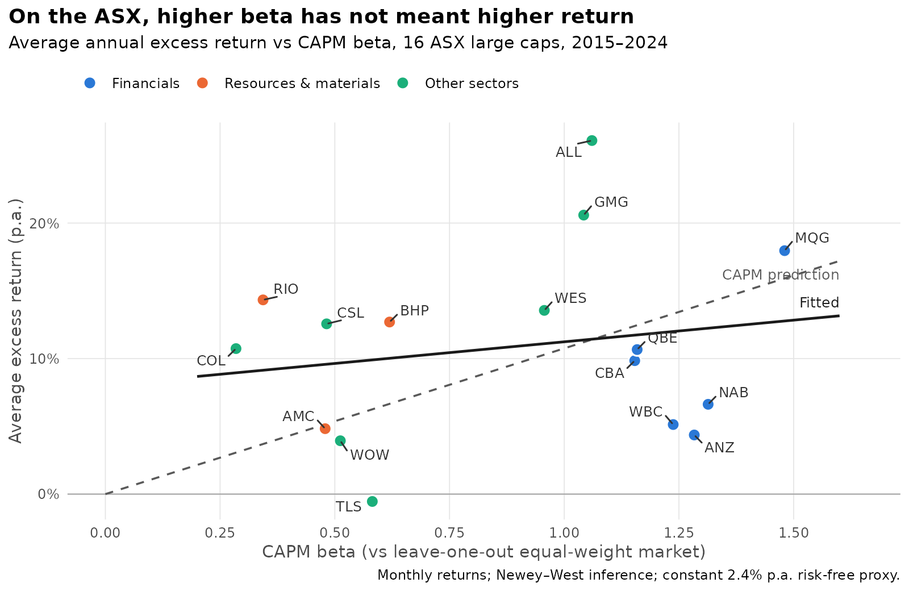

# APAC Capital Markets Analysis

Do asset pricing models built on US data hold in Asia-Pacific markets? This repo tests the CAPM and factor models on APAC equities, starting with the ASX.

**First study:** [Does the CAPM price ASX large caps?](https://kyanite03.github.io/apac-capital-markets-analysis/reports/capm_asx.html) ([Read online](https://kyanite03.github.io/apac-capital-markets-analysis/reports/capm_asx.html) · [source](reports/capm_asx.qmd)).

## Executive summary

- **Higher beta has not meant higher return on the ASX.** Across 16 large caps (2015–2024), the security market line is nearly flat: about 3% a year per unit of beta, against an 11% market premium. Low-beta CSL, RIO and Coles earned as much as the high-beta banks. Fama–MacBeth regressions on out-of-sample rolling betas give the same answer.
- **No stock has a convincing CAPM alpha, but the test has little power.** One of 16 alphas is significant (ANZ, −10% a year) and the joint GRS test does not reject (p = 0.31). With 10 years of monthly data, an alpha would need to exceed about ±10% a year to be detected.
- **Betas are unstable.** CBA, NAB, Goodman and Wesfarmers became significantly more market-sensitive after 2020, while BHP, RIO and CSL became less so. A single historical beta is a fragile input for cost-of-equity estimates.

## Problem

The CAPM remains the standard model for the cost of equity in Australian valuation and regulatory work, but most of its empirical testing uses US data. APAC markets differ in ways that could matter: the ASX is concentrated in banks and miners and is tied to the commodity cycle; Hong Kong has a currency peg; China A-shares sit behind capital controls and are dominated by retail investors.

## Approach

- Monthly total returns for 16 ASX large caps across eight sectors, February 2015 to December 2024, pulled from Yahoo Finance with `tidyquant` ([`scripts/ff_asx_setup.R`](scripts/ff_asx_setup.R)).
- Market proxy: an equal-weighted index of the sample. Stock-level regressions use a **leave-one-out** version so that no stock is regressed on itself (this lowers betas by 0.04–0.23).
- Tests:
  - Per-stock time-series CAPM regressions with Newey–West standard errors.
  - The Gibbons–Ross–Shanken joint test of zero alphas.
  - A cross-sectional security market line.
  - Fama–MacBeth regressions on rolling 36-month pre-estimated betas.
  - A split-sample (2015–19 vs 2020–24) test of beta stability.

## Key findings

| | Estimate (p.a.) | t | CAPM predicts |
|---|---:|---:|---|
| SML intercept (cross-section) | 8.0% | 1.83 | 0 |
| SML slope per unit beta | 3.2% | 0.69 | 10.8% (market premium) |
| Fama–MacBeth beta premium (out-of-sample betas) | 2.5% | 0.44 | 11.7% (market premium, same months) |
| GRS joint test of zero alphas | F = 1.17 | p = 0.31 | not rejected |

The flat line matches Black's zero-beta CAPM and the "betting against beta" evidence of Frazzini and Pedersen (2014) in US data. Beta stability results are in [the report](https://kyanite03.github.io/apac-capital-markets-analysis/reports/capm_asx.html) ([chart](figures/beta_stability.png)).

## Tools

R (tidyverse, `tidyquant`, `sandwich`, `lmtest`, `ggplot2`, `ggrepel`) and Quarto. The GRS and Fama–MacBeth tests are implemented directly.

## Repository contents

| Path | What it is |
|---|---|
| `reports/capm_asx.qmd` / `.html` | CAPM study: source and rendered report |
| `figures/` | Charts used in this README and the report |
| `scripts/ff_asx_setup.R` | Data pipeline: downloads prices, builds monthly returns and the market proxy; early Fama–French factor code |
| `data/asx_returns.csv` | Monthly returns by stock (output of the pipeline) |
| `data/asx_market.csv` | Equal-weighted market return and risk-free proxy |

To reproduce: run `scripts/ff_asx_setup.R` from the repo root (optional, refreshes the data), then `quarto render reports/capm_asx.qmd`.

## Limitations

- The market proxy is the sample itself, equal-weighted. It overweights financials relative to the S&P/ASX 200, so the miners' betas are understated.
- The risk-free rate is a constant 2.4% a year. This shifts alpha levels but not betas or slopes.
- 16 of today's large caps is a small, survivor-selected universe. Average returns are biased upward and the cross-sectional tests have low power.
- The size and book-to-market groupings in the pipeline use price-based proxies and are not yet suitable for inference.

## Roadmap

1. **ASX data upgrade:** S&P/ASX 200 accumulation index as the market, RBA cash rate / bank bill rate as the risk-free rate, the full constituent history including delistings, and beta-sorted portfolios.
2. **Fama–French three-factor model:** SMB and HML built from shares outstanding and book equity, with 2×3 portfolio sorts and time-series and Fama–MacBeth tests.
3. **Cross-market comparison:** HKEX, SGX and Shanghai/Shenzhen A-shares (Tushare / AKShare data).
4. **CAPM extensions and APT:** a zero-beta (Black) CAPM, and macro factors (rates, AUD, commodities).
5. **Return dynamics:** GBM vs GARCH vs regime-switching models of volatility clustering and fat tails in APAC indices.

## Author

Kai Marsh, BCom (Finance & Statistics), University of Melbourne · [kai@ksmarsh.net](mailto:kai@ksmarsh.net)
