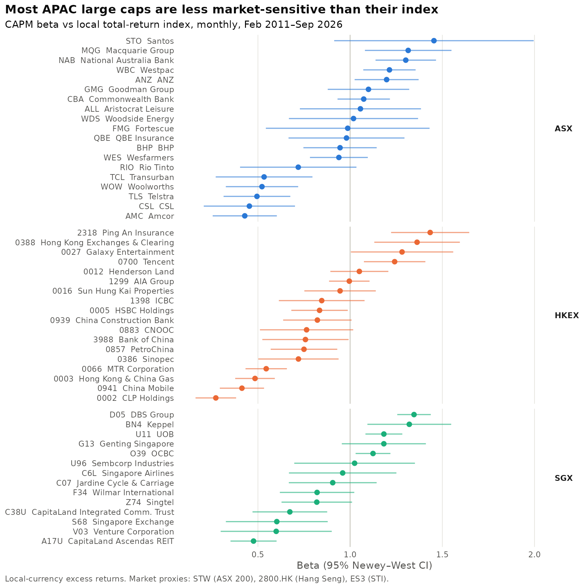

# APAC Asset Pricing

Statistical asset pricing and valuation across the ASX, HKEX and SGX: factor models, valuation, commodities and event studies, in R. Each module opens with its answer, and each feeds the next. Module 01's betas go into Module 06's cost of capital, and Module 03's factor tests set up Module 05's cross-market comparison.

**Read online:** [kyanite03.github.io/apac-asset-pricing](https://kyanite03.github.io/apac-asset-pricing/)

## Latest: Module 01, CAPM and the market model

- **Most APAC large caps move less than their market.** 31 of 51 stocks have a beta below 1. Financials sit above 1. Utilities, telecoms, health care and, perhaps surprisingly, most resource names sit below.
- **Betas shifted after 2020, by sector.** China's big three state banks decoupled from the Hang Seng (beta about 1.2 → 0.5). All eight resource and energy names became less market-sensitive, and all four Australian majors became more so.
- **No stock has a significant alpha** once the 51 tests are corrected for false discoveries.

[Full write-up](https://kyanite03.github.io/apac-asset-pricing/modules/01-capm-market-model/) · [source](modules/01-capm-market-model/index.qmd)

## Modules

| # | Module | Question | Status |
|---|--------|----------|--------|
| 01 | [CAPM and the market model](modules/01-capm-market-model/) | How market-sensitive are APAC large caps, and are their betas stable? | Done |
| 02 | Factor construction | Can SMB/HML be built for the ASX from fundamentals? | Planned |
| 03 | Testing pricing models | CAPM vs zero-beta CAPM vs Fama–French: which prices APAC returns? | In progress |
| 04 | Statistical factors (APT) | How many factors drive APAC returns? | Planned |
| 05 | Cross-market comparison | Are factor premia equal across the three markets? | Planned |
| 06 | DCF: Tencent | Does Tencent deserve its valuation premium? | Planned |
| 07 | Bank valuation, HK & SG | Why do Chinese banks trade at a discount to Singapore's? | Planned |
| 08 | Oil vs energy equities | Is commodity risk priced, or just held? | Planned |
| 09 | The David Jones collapse | Who bore the cost of DJ's administration? | Planned |

## Rigour

- Every estimator is written in matrix form in [`R/models_linear.R`](R/models_linear.R): OLS, Newey–West HAC, GLS, general linear hypotheses, the GRS test, and Fama–MacBeth with Shanken errors.
- Each is unit-tested in [`tests/testthat`](tests/testthat) against `lm()`, `sandwich::NeweyWest` and `car::linearHypothesis` (to 1e-8 or better), and against simulations with a known answer (GRS size and power, Fama–MacBeth premium recovery).
- Returns and risk-free rates are matched by market and currency. The risk-free rate is lagged one month, so it is known at the start of the month it applies to. p-values are corrected for multiple testing when scanning many stocks.

## Repository layout

| Path | Contents |
|---|---|
| `modules/NN-*/index.qmd` | One write-up per module (Quarto) |
| `R/` | Shared functions: data (`data_prices.R`, `data_rates.R`), estimators (`models_linear.R`), chart theme (`plots.R`) |
| `scripts/build_data.R` | Downloads prices and rates; writes `data/processed/` |
| `data/processed/` | Monthly returns, market proxies, risk-free rates, universe, module outputs |
| `tests/testthat/` | Estimator tests |
| `docs/` | Rendered website (GitHub Pages) |

**Reproduce:** `Rscript scripts/build_data.R`, then `Rscript -e 'testthat::test_dir("tests/testthat")'`, then `quarto render`.

## Data caveats

Yahoo Finance data have survivorship bias (delisted firms are missing), occasional adjusted-close errors around corporate actions (Thai Beverage is excluded for this reason) and gaps. All monthly moves above 35% were checked against known events. This is fine for a portfolio as long as it is stated, and it is stated in every module.

## Author

Kai Marsh, BCom (Finance & Statistics), University of Melbourne · [kai@ksmarsh.net](mailto:kai@ksmarsh.net)

Code: MIT licence. Text and figures © 2026 Kai Marsh.
